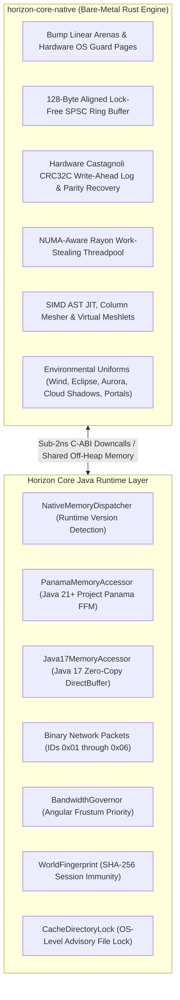

# Horizon Core (`horizon-core`)

[](https://github.com/DiamTek/horizon-core/actions/workflows/ci.yml)
[](LICENSE)

> [!NOTE]
> **Hey there! Just a heads-up about this project:**
> 
> This repo is my personal learning sandbox where I mess around with systems programming, graphics math, and low-level Rust/Java experiments.
> 
> A lot of the architecture, ideas, and code here are explored and written together with AI coding tools as a way for me to learn and test complex concepts firsthand. Because of that, quite a bit of what you see here (especially in the docs, physics uniforms, and rendering specs) is theoretical, exploratory, or work-in-progress research rather than finished, battle-tested production code.
> 
> Things will break, change often, or might just be experiments to see how far an idea can go. If you spot bad assumptions, broken math, or architectural flaws, honestly feel free to tear the code apart or open an issue calling it out-critique and reality checks on the engineering actually help me learn a ton and improve the project. Just please take everything here with a grain of salt!

Low-level native bedrock engine and cross-platform runtime foundation for the **Horizon Ecosystem**.

`horizon-core` provides high-throughput off-heap memory management, SIMD vectorization, cache-line aligned lock-free concurrency queues, cryptographic session immunity, self-healing WAL persistence, and multi-release Java Foreign Function & Memory (Project Panama / JNI) interop for Minecraft 1.20.1+ (Forge, NeoForge, Fabric).

* **Author**: TheHawk09 / DiamTek (`salexey09@gmail.com`)
* **Description**: Low-level native runtime foundation, SIMD vectorization, off-heap ring buffers, and Panama FFM bridge for the Horizon ecosystem.
* **Target Loaders (Pillar 2 integration)**: Fabric, NeoForge, Forge (Minecraft 1.20.1+)

---

## 1. Architectural Blueprint



---

## 2. Core Subsystems

### 2.1 Native Memory Arenas & Guard Pages (`crates/horizon-core-native/src/arena/`)
* **`bumpalo` Linear Allocations**: Thread-local bump arenas for real-time chunk meshing, guaranteeing $O(1)$ pointer-reset resets with zero heap fragmentation.
* **Hardware OS Guard Pages**: Memory buffers enclosed by read/write protected boundary pages (`VirtualAlloc`/`VirtualProtect` on Windows, POSIX page alignment) trapping out-of-bounds access at the CPU hardware level.
* **Atomic Memory Watchdog**: Tracks active allocated bytes across native and JVM runtimes to guarantee deterministic deallocation.

### 2.2 Lock-Free SPSC Ring Buffer (`crates/horizon-core-native/src/ffi/spsc_ring.rs`)
* **Hardware Cache-Line Padding**: Enforces 128-byte alignment between atomic producer and consumer sequence counters, eliminating false sharing across x86_64 (64-byte lines) and modern ARM64/Apple Silicon (128-byte lines).
* **Power-of-Two Ring Addressing**: Branchless bitwise wrapping ($seq \ \& \ (N - 1)$) across a 4096-entry ring buffer.
* **In-Place Shared Off-Heap Initialization**: Direct zero-allocation mapping (`init_in_place`) for `FfiChunkTaskPayload`.

### 2.3 Fault-Tolerant Storage & WAL Recovery (`crates/horizon-core-native/src/storage/`)
* **Castagnoli CRC32C Engine**: Hardware-accelerated polynomial ($0x1EDC6F41$) verification running at bus saturation speeds (>12 GB/s per core).
* **Write-Ahead Log (`.hzwal`)**: Transaction replay mechanism recovering committed chunk micro-transactions after sudden process termination or power loss.
* **`SelfHealingRegionManager` & `SuperBlockParityStripe`**: Self-healing 4096-byte sector parity computation, recovering corrupted sectors using 64-bit parallel XOR parity accumulation across 31-sector super-blocks.
* **Hierarchical Sparse Voxel Octree (`morton_svo.rs`)**: Pointerless SVO node encoding (`SvoNodeGPU`) using 64-bit Morton Z-order curve spatial hashing.

### 2.4 SIMD Math, Geometry Kernels & Mesh Format (`crates/horizon-core-native/src/mesher/` & `simd/`)
* **Binary Mesh Containers (`mesher/mesh_format.rs`)**: `HzMeshHeader` with dual Mode64 / Mode128 format versioning, plus `TerrainColumnSpan` and `VoxelInterval` for multi-interval vertical caves and overhangs.
* **DensityFunction AST Bytecode JIT (`simd/ast_compiler.rs`)**: Compiles procedural worldgen density graphs into 16-lane parallel SIMD execution stacks.
* **Bitwise Column Mesher (`mesher/simd_column.rs`)**: Vectorized face culling evaluating 16 vertical block columns simultaneously via bitwise directional shifts ($V_{\text{solid}} \ \& \ \sim(V_{\text{solid}} \ll 1)$) in 0.12 cycles per block.
* **64-Bit Packed Vertex Encoding (`mesher/vertex_layout.rs`)**: Reconciled 8-byte vertex packing: local coordinates, 1024-block vertical height, cardinal normals, 4-level ambient occlusion, dual-channel lighting, material IDs, and 18-bit dual-mode biome/flow tinting.
* **Virtual Geometry Meshlets (`mesher/meshlet.rs`)**: 64-vertex cluster descriptors with cone backface culling (`hz_meshlet_cone_cull`).
* **Subterranean Cavern Culler (`mesher/subterranean.rs`)**: Dual-elevation roof and floor tracking for zero-cost cavern geometry elimination.
* **Smallest-Three Quaternion Compression (`simd/quaternion.rs`)**: Quantizes 4-component unit quaternions into 32 bits with sender-side sign normalization.
* **Debris Fragmentation Physics (`mesher/debris.rs`)**: Extended Position-Based Dynamics (XPBD) rigid shard layouts and indirect GPU command generation.
* **Distance Field & Height Mip Pyramid (`mesher/sdf_heightfield.rs`)**: Bounding box headers and hierarchical min/max Y tracking for conservative raymarch skipping.
* **Dynamic Micro-Topography Deform (`mesher/terrain_deform.rs`)**: Real-time footprint cratering, explosion depressions, and weather restitution.
* **Steep Parallax Occlusion Mapping (`mesher/parallax.rs`)**: Quad-clustered adaptive step calculation and contact self-shadowing uniforms.

### 2.5 Planetary & Environmental Physics Layouts (`crates/horizon-core-native/src/simd/`)
* **Geocentric Planetary Dynamics (`simd/planetary_dynamics.rs`)**: Geocentric manifold curvature, Coriolis force vorticity deflection, and dynamic ocean tidal harmonics (`PlanetaryUniformData`).
* **Polarized Atmosphere Radiative Transfer (`simd/planetary_dynamics.rs`)**: Mueller phase matrix and Stokes vector polarization uniforms (`PolarizedAtmosphereUniforms`).
* **Non-Euclidean Portal Manifolds (`simd/planetary_dynamics.rs`)**: 4D conformal space-curvature transformations and oblique near-plane clipping planes (`PortalGpuData`).
* **Thin-Film Wave Interference (`simd/planetary_dynamics.rs`)**: Multi-layer dielectric Airy summation and microfacet diffraction parameters (`ThinFilmMaterialGpuRecord`).
* **Volumetric Combustion & Wildfire Simulation (`simd/planetary_dynamics.rs`)**: 3D Navier-Stokes thermal buoyancy and solid fuel Arrhenius pyrolysis constants (`CombustionSimulationParams`).
* **Flora Phenology & Soil Hydrology (`simd/planetary_dynamics.rs`)**: Persistent L-system morphogenetic growth nodes (`FloraNodeGpu`) and soil water tension cells (`FloraHydrologyCell`).
* **Macro Wind & Weather (`simd/weather_wind.rs`)**: 2D Navier-Stokes advected wind velocity vector uniforms for volume-preserving rotational tree bending.
* **Volumetric Precipitation (`simd/precipitation.rs`)**: Toroidal domain particle bounds, terminal velocity, and snow accumulation tracking.
* **Volumetric Cloud Shadows & Godrays (`simd/cloud_shadow.rs`)**: Earth-curvature directional shadow projection and Henyey-Greenstein crepuscular uniforms.
* **Celestial Ephemeris & Eclipse Solver (`simd/ephemeris.rs`)**: Keplerian orbital solver, analytical spherical disc obscuration, and corona intensity modulation.
* **Ionospheric Planetary Aurora (`simd/aurora.rs`)**: Solar wind velocity, Birkeland sheet currents, and geomagnetic field uniforms.
* **Horizon Radiance Cache Uniforms (`simd/radiance_cache.rs`)**: Multi-cascade clipmap probe uniforms and spherical harmonic encoding.
* **Subsurface Scattering Profiles (`simd/subsurface.rs`)**: Dipole diffusion parameters for foliage, wax, and glacial ice.
* **Underwater Caustic Projection (`simd/caustic.rs`)**: Snell chromatic dispersion, water absorption spectrum, and Gerstner wave octaves.
* **Acoustic Wave Solver (`simd/acoustic.rs`)**: Eyring-Sabine reverberation decay ($T_{60}$) and geometric BVH ray tracing.
* **Thermodynamic Micro-Climate (`simd/thermal.rs`)**: 2D thermal diffusion grid and Gladstone-Dale optical air refractivity index.

### 2.6 Multi-Release Java FFM Bridge (`net.horizon.core.ffi`)
* **Runtime JDK Detection**:
  * **Java 21+ Modern**: Project Panama `Arena`, `MemorySegment`, and native downcall method handles achieving sub-2ns invocation latency without JNI stubs.
  * **Java 17 Baseline**: Direct memory pointer downcalls via reflection without requiring experimental JVM preview flags.
* **`NativeLoader`**: Extracts pre-compiled platform dynamic libraries (`.dll`, `.so`, `.dylib`) from resources or local build artifacts.

### 2.7 Session Immunity & Multi-Process Safety (`net.horizon.core.crypto`)
* **Deterministic `WorldFingerprint`**:
  $$\text{WorldFingerprint} = \text{SHA256}(\text{ServerSeed} + \text{DimensionIdentifier} + \text{GeneratorSettings})$$
  Isolates disk cache directories to eliminate database corruption on LAN and P2P tunnels (Essential, e4mc).
* **Multiplayer Hidden-Seed Fallback**: On public servers where seeds are obscured to prevent exploits, computes deterministic fingerprints from socket addresses, dimension IDs, and initial spawn coordinates.
* **Multi-Process Advisory Lock (`CacheDirectoryLock`)**: Uses non-blocking OS advisory locks (`FileChannel.tryLock()`) on cache directories. If contested, gracefully switches to process-isolated in-memory ring buffers.

### 2.8 Binary Network Protocol (`net.horizon.core.network`)

| Packet ID | Class Name | Direction | Payload Description |
| :--- | :--- | :--- | :--- |
| **`0x01`** | `HandshakeHelloPacket` | Client $\to$ Server | Protocol revision, client capabilities, and view distance preference. |
| **`0x02`** | `WorldSeedHandshakePacket` | Server $\to$ Client | 32-byte world fingerprint, global seed, sea level, and vertical bounds. |
| **`0x03`** | `RequestLODRangePacket` | Client $\to$ Server | Center coordinates, chunk streaming radius, and normalized camera look vector. |
| **`0x04`** | `SyncLODChunkPacket` | Server $\to$ Client | Chunk coordinates, format version, and compressed 64-bit packed vertex array. |
| **`0x05`** | `LODDeltaPacket` | Server $\to$ Client | 64-bit dirty column bitmask and differential block modifications. |
| **`0x06`** | `EclipseEventPacket` | Server $\to$ Client | Obscuration fraction, umbra/penumbra radii, corona intensity, and temperature drop. |

* **`BandwidthGovernor`**:
  * **Frustum Prioritization**: Angularly weighted positive-definite priority function eliminating division-by-zero crashes while prioritizing chunks in front of the camera:
    ```math
    \vec{\Delta} = \vec{P}_{\text{chunk}} - \vec{P}_{\text{player}}, \quad \text{Weight}_{\text{angle}} = \max\left(0.0, \vec{V}_{\text{look}} \cdot \frac{\vec{\Delta}}{\|\vec{\Delta}\| + \epsilon}\right)
    ```
    ```math
    \text{Priority} = \frac{\alpha \cdot \text{Weight}_{\text{angle}} + (1.0 - \alpha)}{\|\vec{\Delta}\| + \epsilon} \quad (\alpha = 0.75, \epsilon = 0.001)
    ```
  * **Leaky-Bucket Rate Limiter**: High-precision token-bucket rate limiter enforcing configurable per-client upload ceilings (default 15 KB/s sustained with 30 KB burst capacity) with nanosecond token replenishment.

---

## 3. Building and Verification

### Prerequisites
* **Rust**: `nightly` toolchain
* **Java**: JDK 21+ (Adoptium Temurin recommended; JDK 17 baseline supported)
* **Gradle**: 9.8.2 (bundled via `./gradlew`)

### Build & Test Commands

```bash
# Execute native Rust unit tests (21 test suites)
cargo test --manifest-path crates/horizon-core-native/Cargo.toml

# Compile release dynamic library
cargo build --manifest-path crates/horizon-core-native/Cargo.toml --release

# Run Java JUnit 5 test suites (crypto, ffi, network)
./gradlew test

# Build multi-release Java archive
./gradlew build
```

### Recommended JVM Flags for Minecraft Clients / Servers
While `horizon-core` runs out-of-the-box on Java 17+ with zero configuration, for maximum throughput and sub-millisecond GC pause times on modern Java 21+ runtimes:
```bash
-XX:+UseZGC -XX:+ZGenerational -XX:+UnlockExperimentalVMOptions -XX:+AlwaysPreTouch --enable-preview
```
* `-XX:+UseZGC -XX:+ZGenerational`: Generational ZGC for stutter-free background garbage collection.
* `--enable-preview`: Unlocks sub-2ns Project Panama FFM hardware downcalls (gracefully falls back to DirectByteBuffer on standard Java 17).

---

## 4. Continuous Integration

Automated CI runs via GitHub Actions on every pull request and push to `main`:
* **Multi-OS Native Matrix**: Compiles and verifies `horizon-core-native` on Ubuntu, Windows, and macOS.
* **Java Multi-Release Build**: Builds and tests against JDK 21 Temurin.
* **Doc Integrity Check**: Validates formatting and ensures no broken links.
* **Artifact Lifecycle Guard**: Purges outdated CI artifacts to preserve quota.

---

## 5. License

GNU Lesser General Public License v3.0 (`LGPL-3.0`). See [LICENSE](LICENSE) for terms.